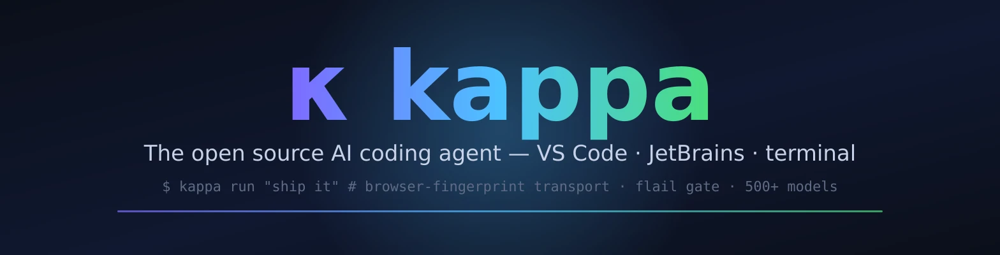

<div align="center">



[](LICENSE)
[](https://bun.sh)
[](https://typescriptlang.org)

**⚡ kappa — the engine**

_The open source AI coding agent: CLI/TUI runtime, editor extensions, gateway, build tooling. Fork of [Kilo Code](https://github.com/Kilo-Org/kilo-code) (itself a fork of opencode). Part of the [kappa monorepo](https://github.com/toxicwind/kappa)._

[Docs](packages/kappa-docs/) · [VS Code](packages/kappa-vscode/) · [JetBrains](packages/kappa-jetbrains/) · [CLI](packages/cli/)

</div>

## What's here

Every subproject — editor extensions, CLI, gateway, build tooling, secret
management — lives under `packages/` in one Bun-workspaces monorepo with the
`@kappacode/*` scope.

| Package                                                  | Scope                      | What it is                                                 |
| -------------------------------------------------------- | -------------------------- | ---------------------------------------------------------- |
| [`packages/core/`](packages/core/)                       | `@kappacode/core`          | Runtime: providers, plugins, config, sessions, models, MCP |
| [`packages/cli/`](packages/cli/)                         | `@kappacode/cli`           | The standalone CLI binary (`kappa`)                        |
| [`packages/kappa-gateway/`](packages/kappa-gateway/)     | `@kappacode/kappa-gateway` | HTTP API gateway for model routing                         |
| [`packages/kappa-vscode/`](packages/kappa-vscode/)       | `@kappacode/vscode`        | VS Code extension                                          |
| [`packages/kappa-jetbrains/`](packages/kappa-jetbrains/) | `@kappacode/jetbrains`     | JetBrains plugin                                           |
| [`packages/kappa-console/`](packages/kappa-console/)     | `@kappacode/kappa-console` | Settings UI (providers, models, keybindings, MCP)          |
| [`packages/kappa-docs/`](packages/kappa-docs/)           | `@kappacode/kappa-docs`    | Documentation site                                         |
| [`packages/ui/`](packages/ui/)                           | `@kappacode/ui`            | Shared component library                                   |
| [`packages/forge/`](packages/forge/)                     | `@kappacode/forge`         | Build daemon integration                                   |
| [`packages/nativelink/`](packages/nativelink/)           | `@kappacode/nativelink`    | Remote build cache (Nativelink RE API)                     |
| [`packages/secretsmith/`](packages/secretsmith/)         | `@kappacode/secretsmith`   | Secret management (OS keyring)                             |
| [`packages/shims/`](packages/shims/)                     | `@kappacode/shims`         | System shims (git hooks, env fix, prompt units)            |
| [`packages/config/`](packages/config/)                   | `@kappacode/config`        | Configuration schemas & validation                         |
| [`packages/protocol/`](packages/protocol/)               | `@kappacode/protocol`      | Wire protocol definitions                                  |
| [`packages/schema/`](packages/schema/)                   | `@kappacode/schema`        | JSON schema definitions                                    |
| [`packages/sdk/`](packages/sdk/)                         | `@kappacode/sdk`           | JS/TS SDK                                                  |

## Quick start

```bash
git clone https://github.com/toxicwind/kappa-code.git && cd kappa-code
bun install
KAPPA_SKIP_BUNDLED_BWRAP=1 bun run --cwd packages/cli script/build.ts --single --skip-install
./packages/cli/dist/@kappacode/cli-linux-x64/bin/kappa
```

## Build

```bash
# CLI binary — full build (requires Zig for bubblewrap)
bun install && bun run --cwd packages/cli script/build.ts

# All packages
bun install          # workspace deps
bun run typecheck    # all packages
bun run build        # build all packages
```

### Remote-cached route

`bun run make:nativelink` builds through the mise `kappa-build` task with
remote build caching (`mise.toml` `[task_config.cache]` is the SSOT;
`BUN_BUILD_REMOTE_CACHE` is dead code). `bun run make` builds locally.

### Versioning

- Preview builds version dynamically as `0.0.0-<branch>-<timestamp>` unless
  `KAPPA_VERSION` / `KAPPA_BUMP` is set — see [`.env.example`](.env.example)
  for the full `KAPPA_*` list.
- The `packages/cli/bin/kappa` wrapper resolves the local compiled artifact in
  `dist/` before global discovery or platform packages.
- Sessions live in `~/.local/share/kappa/kappa-<channel>.db`; `safeChannelToken()`
  (in `packages/core/src/installation/version.ts`) guarantees a stable
  non-empty channel so dev builds never fork the session database.

## Fork features

Two model-resilience features on top of upstream, one idea: **never trust what
a provider claims — measure what the endpoint actually does.**

- **Browser-fingerprint HTTP transport** — reach Cloudflare-guarded providers
  by forwarding with Chrome-aligned headers. Opt in per provider with
  `"http": { "fingerprint": "chrome" }`.
- **Flail Gate** — model-agnostic loop/narration resilience: detects tool-call
  loops, narration instead of action, and reasoning re-derivation at runtime.
  Config: `~/.config/kappa/flail-gate/gate.json`.

Full detail and implementation links: [kappa monorepo README → Fork features](https://github.com/toxicwind/kappa#the-flail-gate--the-headline-feature).

## Contributing

1. Fork → `bun install` → change things in the relevant `packages/*`
2. Check: `bun run typecheck` + `bun test` (from the touched package, never root)
3. PR with a conventional-commit title (`type(scope): summary`)

Shared-upstream edits carry `kappacode_change` markers; kappa-specific code
lives in `kappacode/`-named paths. Details in [`AGENTS.md`](AGENTS.md).

## License

MIT
