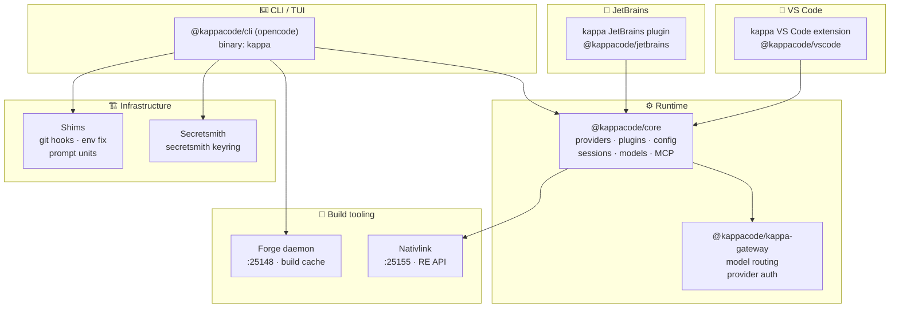

[](LICENSE)
[](https://bun.sh)
[](https://typescriptlang.org)

<div align="center">

# ⚡ kappa

**The open source AI coding agent — estate-forked, monorepo-organized, first-class with forge/nativelink.**

*The Greek-letter sibling of tau (τ). Kilo Code renamed: a coding agent that meets you everywhere — VS Code, JetBrains, the CLI.*

<p align="center">
  <a href="packages/kappa-console/">Explore the docs »</a>
  ·
  <a href="packages/kappa-vscode/">VS Code</a>
  ·
  <a href="packages/kappa-jetbrains/">JetBrains</a>
  ·
  <a href="packages/cli/">CLI</a>
</p>

</div>

## ⚡ The kappa, in one picture



## 🔍 Tour it live — 5 commands

```bash
# 1. Check kappa CLI version
kappa --version

# 2. Check forge build daemon health
curl -s http://127.0.0.1:25148/api/health

# 3. List available models via the gateway
curl -s http://127.0.0.1:25148/v1/models | head -c 300

# 4. List workspace packages
bun run --cwd packages/cli -- list-scripts

# 5. Build the CLI binary
KILO_SKIP_BUNDLED_BWRAP=1 bun run --cwd packages/cli script/build.ts --single
```

<details>
<summary><b>Table of Contents</b></summary>

1. [About](#-about)
2. [The monorepo](#-the-monorepo)
3. [Packages](#-packages)
4. [Build](#-build)
5. [Estate integration](#-estate-integration)
6. [Getting started](#-getting-started)
7. [Contributing](#-contributing)
8. [License](#-license)

</details>

## 🏔️ About

**kappa** is the estate-forked monorepo of Kilo Code, reorganized as a proper bun workspaces monorepo with the `@kappacate/*` scope. Every subproject — editor extensions, CLI, gateway, build tooling, secret management — lives under `packages/` and is versioned and linked.

The answer to *what does it take to run a serious AI coding agent on a live estate*:

- **A unified runtime** that treats every workspace (VS Code, JetBrains, CLI) as first-class. `@kappacode/core` owns the model routing, plugin system, session management, and MCP server lifecycle.
- **A gateway** for provider routing and auth. `@kappacode/kappa-gateway` sits in front of model providers, handling key rotation, rate limiting, and health checks.
- **Build tooling that lives on the box.** Forge (:25148) and Nativlink (:25155) are first-class package dependencies — not external build scripts. The mise `[task_config.cache]` section routes through forge for remote build caching.
- **Secrets in the keyring.** `@kappacode/secretsmith` wraps the estate's secretsmith keyring (freedesktop Secret Service via D-Bus). No secrets in config commits.
- **Shims everywhere.** `@kappacode/shims` provides git hooks, env-sanity fixes, and ble.sh prompt units — making kappa a first-class citizen in the shell environment.

### Built with

TypeScript (Bun) · Effect · Solid.js · Hono · Turborepo · Zig · Rust

## 🐝 The monorepo

All projects live under `packages/`. The bun workspace resolves dependencies across the entire tree.

| Package | Path | Scope | What it is |
|---|---|---|---|
| Core | `packages/core/` | `@kappacode/core` | Runtime: providers, plugins, config, sessions, models, MCP |
| CLI | `packages/cli/` | `@kappacode/cli` | The standalone CLI binary (`kappa` command) |
| Gateway | `packages/gateway/` | `@kappacode/kappa-gateway` | HTTP API gateway for model routing |
| VS Code | `packages/vscode/` | `@kappacode/vscode` | VS Code extension |
| JetBrains | `packages/jetbrains/` | `@kappacode/jetbrains` | JetBrains plugin |
| Console | `packages/console/` | `@kappacode/kappa-console` | Settings UI (providers, models, keybindings, MCP) |
| UI | `packages/ui/` | `@kappacode/ui` | Shared component library |
| Docs | `packages/docs/` | `@kappacode/kappa-docs` | Documentation site |
| Forge | `packages/forge/` | `@kappacode/forge` | Build daemon integration (estate forge :25148) |
| Nativlink | `packages/nativelink/` | `@kappacode/nativelink` | Remote build cache (Nativlink RE API) |
| Secretsmith | `packages/secretsmith/` | `@kappacode/secretsmith` | Secret management (secretsmith keyring) |
| Shims | `packages/shims/` | `@kappacode/shims` | System shims (git hooks, env fix, prompt units) |
| Config | `packages/config/` | `@kappacode/config` | Configuration schemas & validation |
| Protocol | `packages/protocol/` | `@kappacode/protocol` | Wire protocol definitions |
| Schema | `packages/schema/` | `@kappacode/schema` | JSON schema definitions |
| SDK | `packages/sdk/` | `@kappacode/sdk` | JS/TS SDK |

## 🔧 Build

### CLI binary

```bash
# Full build (requires Zig for bubblewrap)
bun install && bun run --cwd packages/cli script/build.ts

# Skip bubblewrap build
KILO_SKIP_BUNDLED_BWRAP=1 bun run --cwd packages/cli script/build.ts --single

# Output → packages/cli/dist/@kappacode/cli-linux-x64/bin/kappa
```

### All packages

```bash
bun install                    # workspace deps
bun run typecheck              # all packages
bun run build                  # build all packages
```

### Remote build cache (estate forge)

```bash
# mise.toml task config routes through forge :25148
mise run kappa-build
```

## 🏗️ Estate integration

This fork is integrated with the estate build pipeline:

- **Forge build daemon** (`:25148`) — remote build cache, `mise run kappa-build`
- **Nativlink** (`:25155`) — RE API for remote execution (package: `@kappacode/nativelink`)
- **Secretsmith** — secretsmith keyring for secret management (package: `@kappacode/secretsmith`)
- **Mise** — task runner with remote cache (`mise.toml`)
- **Kappa binary** installed at `/usr/lib/kappa/kappa` (via `/usr/bin/kappa` → `/usr/lib/kappa/kappa`)

## 🚀 Getting started

```bash
git clone https://github.com/toxicwind/ranch/tree/main/kilo
cd ranch/kilo/kappa-code
bun install
bun run typecheck
```

## 📝 Contributing

1. Fork
2. `bun install`
3. Make changes in the relevant `packages/*`
4. `bun run typecheck` + `bun test`
5. PR

## License

MIT
